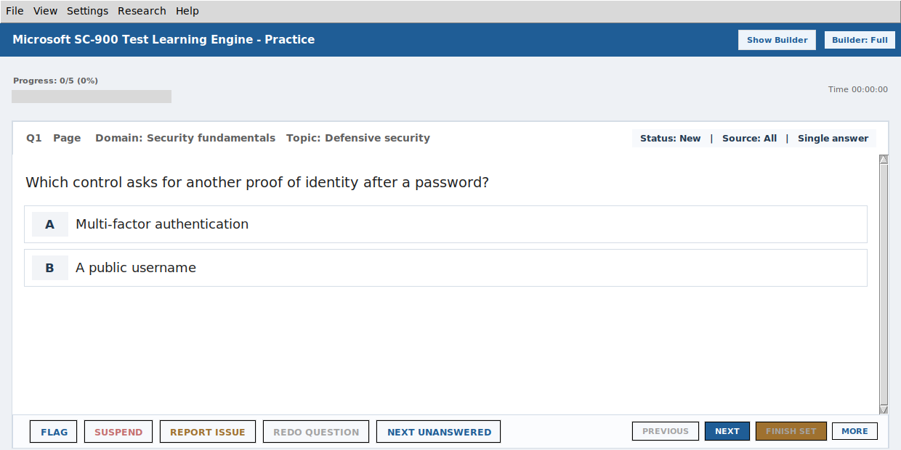

# Learning-engine evidence — October 24, 2026

This record supports the portfolio case for Don Lopez's public study software.
The actual SC-900 Python/Tk application was rendered on Linux with an isolated
learner directory and five original portfolio example questions. The unchanged
application source was used; no private learner files or question-bank content
were copied into the portfolio.

## Exact source revisions

| Project | Reviewed revision | Evidence exercised |
| --- | --- | --- |
| [SC-900](https://github.com/IXI-2773/Microsoft_SC-900_Test_Learning_Engine/tree/250e55565582f9e6dc1f5608f7701aea5e9e953f) | `250e55565582f9e6dc1f5608f7701aea5e9e953f` | Actual practice UI; 49 focused tests |
| [Security+](https://github.com/IXI-2773/Comptia-SY0-701-Test-Learning-Engine/tree/5c099196525f2df236d4c80069e2b3a00a70bf94) | `5c099196525f2df236d4c80069e2b3a00a70bf94` | Five focused local checks; no GUI capture |

## Captured interface

- Runtime: Linux / Tk / Xvfb, 1240 × 620 pixels.
- Session: five original example questions, Practice mode, no learner history.
- Screenshot SHA-256: `fe8f01b10fe7c4f313c3ae438b965a3262fd23f15deaea422135fbd0a564ed3f`.
- Example bank SHA-256: `5661542f7a879932ae90e13d2ae97355ffcd8a7100de61d0bf385bdad12d053f`.
- [Capture script](../scripts/capture_learning_engine.py) and [workflow](../.github/workflows/learning-engine-evidence.yml).
- [Successful capture and test run](https://github.com/IXI-2773/Cybersecurity_Portfolio/actions/runs/40080205032).

The image is a real application rendering, not a conceptual mockup. It does not
show a Windows executable run or the production question bank.

## Focused SC-900 checks

All 49 passed on the pinned source in the linked run, without skips:

| Existing test module | Count | What it supports |
| --- | ---: | --- |
| `test_smart_practice_core.py` | 2 | Selection role mix and non-mutating scoring |
| `test_smart_practice_continuity_spacing_tranche_a.py` | 40 | Exact-item spacing, deterministic selection, foreground/worker agreement, and session continuity |
| `test_backlog1_segment2_session_app_integration.py` | 7 | Answer restoration by canonical ID, changed-bank rejection, and legacy-session quarantine |

The spacing tests use a fixed evaluation time and a 72-hour threshold. An item
just under that threshold is excluded from normal eligibility; exactly at the
threshold it becomes eligible. This is a scheduling behavior check, not a
measurement of recall improvement.

The session tests deliberately reorder two questions. The saved answer for
`Q-A` remains attached to `Q-A`, while `Q-B` stays unanswered. The restoration
test exercises the application mixin using a small test harness; it is not a
manual Windows restart test.

## Focused Security+ checks

Two existing Smart Practice core tests and these three existing storage tests
passed locally on the pinned source:

- `test_corrupt_json_is_moved_aside`
- `test_runtime_persistence_handles_progress_backups_and_checkpoint_writes`
- `test_session_snapshot_migration_backfills_restore_identity_and_limit`

## Scope

Only the named checks were run for this case-study evidence. This record does
not establish full-suite coverage, Windows package behavior, certification
readiness, learning effectiveness, or an official Microsoft/CompTIA endorsement.
