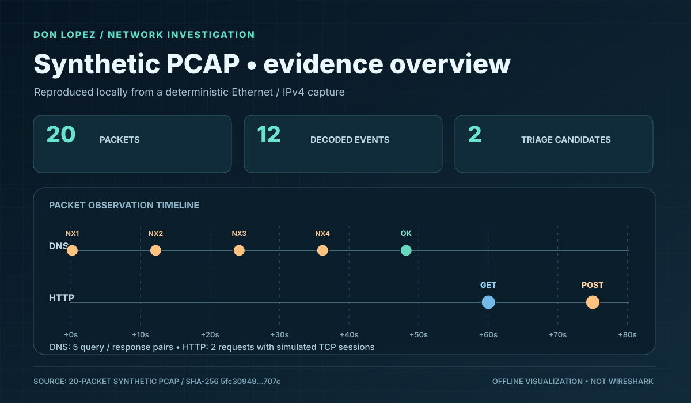
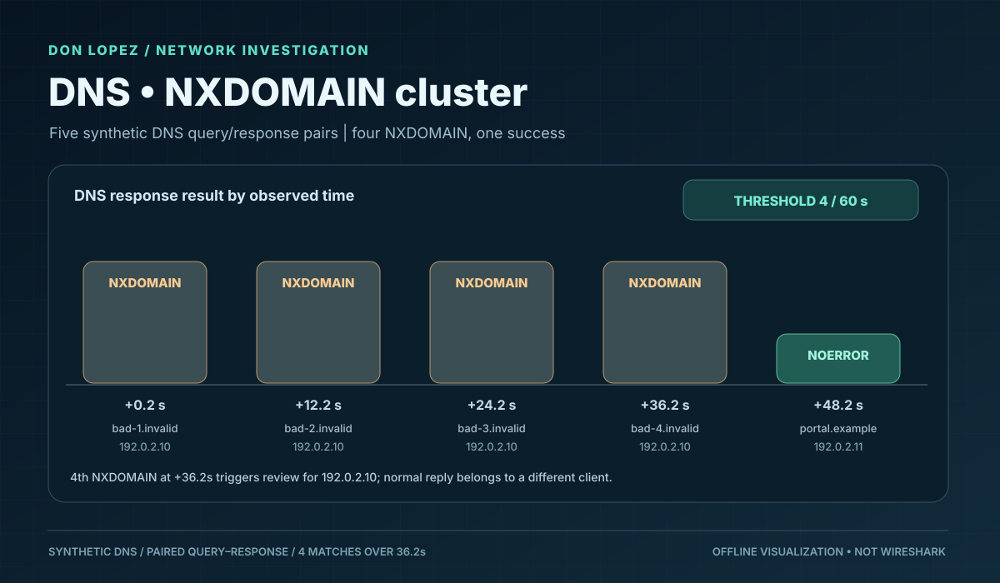
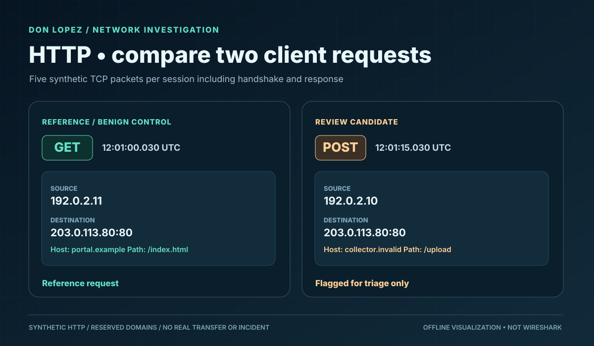

# Network Traffic Analysis — Synthetic DNS and HTTP PCAP

**Author:** Don Lopez · **Status:** 18 local unit tests passed · **Dependencies:** Python 3.10+ standard library only.

This is a **real PCAP-format file generated entirely offline**. No packets were captured from a device, sent across a network, or obtained from an organization.

## Run from repository root

```bash
python projects/03-network-pcap/generate_fixture.py --output projects/03-network-pcap/synthetic_traffic.pcap
python projects/03-network-pcap/analyze_pcap.py projects/03-network-pcap/synthetic_traffic.pcap
python -m unittest discover -s projects/03-network-pcap -p 'test_*.py' -v
```

Expected: **1,907-byte PCAP, 20 Ethernet/IPv4 packets, 12 decoded DNS/HTTP events, two findings and 18 tests**.

Deterministic PCAP SHA-256:
```
5fc309499252677ba5cd31106b611edde5fd1b941aed3cc2f87f216da4dd707c
```

The binary is generated rather than tracked in Git. You can also download a generated PCAP from a successful CI run's artifact. [Frozen expected findings](expected_findings.json) are independently authored.

## Visual evidence gallery (synthetic, not Wireshark screenshots)

The figures below summarize *actual decoded events from the fabricated PCAP*. They are vector images stored in the public repository and can be inspected at full resolution.







**Evidence classification:** Offline illustrations from the deterministic fixture. They are **not** screenshots from Wireshark or live security tooling, and they make no claim of malicious activity.

## Analyst report and disposition

[LAB-NET-001 — source-attributed packet investigation](CASE_REPORT.md) links the two findings to exact **UTC timestamps, generated frame numbers, rule conditions, benign controls and missing corroboration**. The documented decision is `SYNTHETIC_REVIEW_ONLY`: the test data do not establish C2 or exfiltration.

## Review findings

| Rule | Synthetic behavior | Limit |
| --- | --- | --- |
| `NET_DNS_NXDOMAIN_BURST` | 4 NXDOMAIN replies in 36 seconds from `192.0.2.10`, paired to prior DNS questions | **Not** proof of DNS tunneling |
| `NET_HTTP_POST_RESERVED_HOST` | HTTP POST to `collector.invalid/upload` | **Not** evidence of exfiltration |

DNS and HTTP traffic are documented as possible command-and-control protocols under MITRE ATT&CK [T1071.004](https://attack.mitre.org/techniques/T1071/004/) and [T1071.001](https://attack.mitre.org/techniques/T1071/001/). Here these are **investigation hypotheses only**.

The capture also contains benign controls: a successful DNS lookup and an HTTP GET to `portal.example`. IP addresses are reserved documentation addresses, and the domains use reserved `.invalid` and `.example` suffixes.

## Optional Wireshark inspection (not completed)

Open the generated `synthetic_traffic.pcap` in Wireshark and test these display filters:

```text
dns
dns.flags.rcode == 3
http.request
http.request.method == "POST"
ip.addr == 192.0.2.10
```

Confirm the DNS errors and POST against the benign comparison traffic, then capture authentic screenshots with Wireshark version, filter, packet/frame numbers and PCAP checksum. **Manual Wireshark runtime verification remains pending.** Do not label this Python output as Wireshark results.

## Scope and safety

The Python analyzer is intentionally bounded: classic little-endian microsecond PCAP only; Ethernet II, unfragmented IPv4, UDP DNS A question/response and single-packet unencrypted HTTP. It rejects inputs over 2 MiB or 10,000 packet records. It is **not** a production IDS, TCP stream reassembler, or general-purpose packet parser. It does not support TLS, pcapng, compressed DNS names, IPv6, IP fragmentation, or HTTP spanning packets.

See [the synthetic analyst report](CASE_REPORT.md) for observations, alternatives, missing evidence and proportionate next actions.
