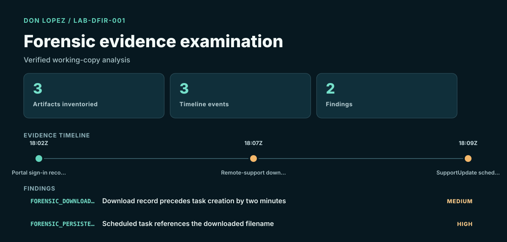

# Forensic Evidence Examination & E3 Experience

**Completed reproducible lab · SHA-256 · artifact timeline · owner-confirmed E3 classroom experience**

LAB-DFIR-001 asks one bounded question: do three supplied artifacts support a download-to-scheduled-task sequence? The workflow verifies the evidence-package hash, copies it to a temporary working location, verifies the copy, inventories its contents and cites every finding to an artifact and timestamp.

The original and working-copy SHA-256 values both equal `409bd208bf9a794f61e72176cc19c713cb81abb29e7b0006612075fed2c64cba`.

## Result

Browser history records a lab download at 18:07 UTC. A scheduled-task artifact references the same filename at 18:09 UTC. This supports a sequence within the fixture; it does not prove execution, maliciousness, intent or attribution.

[Full case report](07-forensic-evidence/CASE_REPORT.md) · [Acquisition manifest](07-forensic-evidence/manifest.json) · [Examination JSON](07-forensic-evidence/examination.json) · [Reproduce the lab](07-forensic-evidence/README.md)

## E3 and methodology

I used Paraben E3 in class. That owner-confirmed experience is separate from this independently created portfolio case. Chuck Easttom's *Digital Forensics, Investigation, and Response, Fourth Edition* informed the high-level method: preserve integrity, minimize original handling, plan the analysis, document methods and cite evidence.

[Paraben E3 overview](https://paraben.com/paraben-e3-forensic-platform/) · [Official textbook publisher page](https://www.jblearning.com/catalog/productdetails/9781284226065)

## Academic foundation

Completed coursework: IST 5250 Incident Handling & Cyber Investigation and IST 4210 Advanced Networking & Security (Fall 2024).

[Explore the academic background](../education.html).

## Scope

All artifacts are lab-created and represent no real person, device, organization or incident. The source files contain no executable and use reserved example domains.
