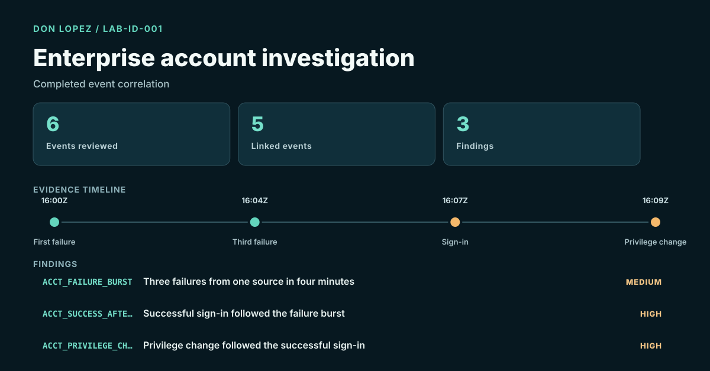

# Enterprise Account Investigation

Completed correlation of six lab-created Windows-style identity events.

The case connects a three-failure burst, later successful sign-in and privileged group change into a five-event timeline while preserving authorized-administration and automation as alternative explanations.

[Case report](06-enterprise-account/CASE_REPORT.md) · [Fixture and analyzer](06-enterprise-account/README.md) · [All case studies](CASE_STUDIES.md)

Academic foundation: IST 4910 Enterprise Systems Administration and IST 5250 Incident Handling & Cyber Investigation (Fall 2024).
