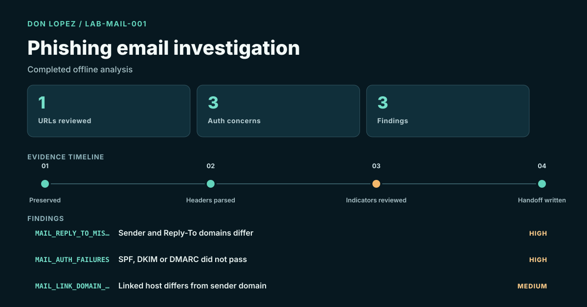

# Phishing Email Investigation

Completed offline analysis of a harmless lab-created RFC 5322 message.

The case preserves the message SHA-256, compares sender and Reply-To domains, reads the supplied SPF/DKIM/DMARC results, extracts and safely defangs one URL, and produces three review findings. No live link, mailbox, domain, attachment, or public target was contacted.

[Case report](05-phishing-email/CASE_REPORT.md) · [Fixture and analyzer](05-phishing-email/README.md) · [All case studies](CASE_STUDIES.md)

Academic foundation: IST 5250 Incident Handling & Cyber Investigation (Fall 2024). This is newly executed portfolio work, not a claim about a recovered class assignment.
