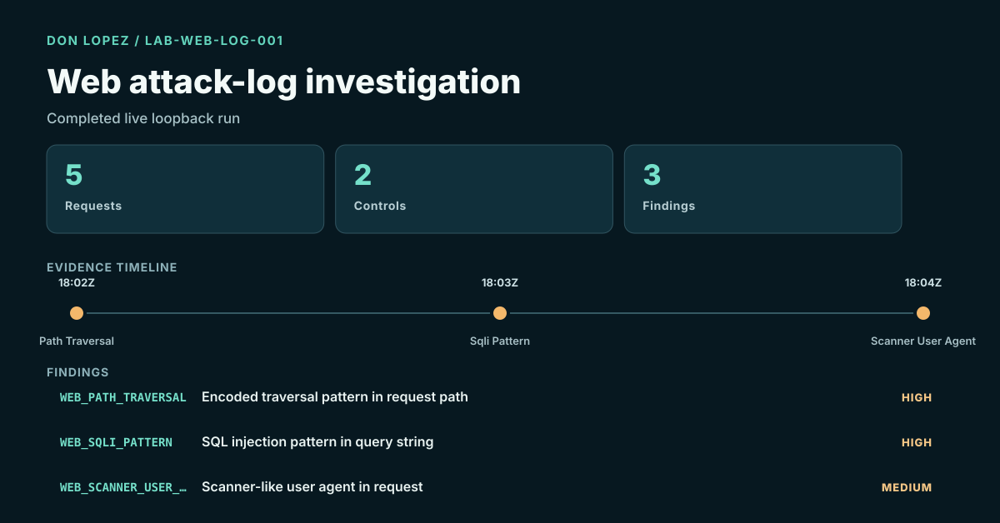

# Web Attack-Log & Hardening Investigation

**Completed localhost-only HTTP investigation and hardening exercise**

Five requests were actually sent to an ephemeral loopback service: two benign controls and three attack-pattern requests. The committed access log produced three review signals without contacting a public target or claiming successful exploitation.

An intentionally vulnerable Python HTTP fixture and a remediated variant are examined using identical rule checks. Both servers bind exclusively to `127.0.0.1`; there is **no external host scanning**.

## Before / after evidence

| Demonstration control | Before remediation | After remediation |
| --- | --- | --- |
| X-Content-Type-Options | Missing | `nosniff` present |
| Content Security Policy | Missing | Restrictive example CSP present |
| Synthetic session cookie | Security attributes missing | `Secure`, `HttpOnly`, `SameSite` present |
| Debug information | Fabricated internal path exposed | Removed |
| **Matched rule conditions** | **4** | **0** |

The [source-linked analyst report](04-local-vulnerability-assessment/CASE_REPORT.md) documents the precise before/after response controls, fixed predicates and an explicit non-production disposition. The findings and severity labels are educational examples, **not independent CVSS assessments** or proof that a deployed website is secure. No production TLS or browser testing occurred.

[Full assessment report](04-local-vulnerability-assessment/CASE_REPORT.md) · [Live access log](04-local-vulnerability-assessment/access.log) · [Run code and tests](04-local-vulnerability-assessment/README.md) · [All case studies](CASE_STUDIES.md)

**Live designed page:** https://ixi-2773.github.io/Cybersecurity_Portfolio/projects/vulnerability-remediation.html

## Academic foundation

Completed coursework: IST 5930 Web System Security seminar (Spring 2023), IST 4620 Penetration Testing & Ethical Hacking and IST 5250 Incident Handling & Cyber Investigation (Fall 2024).

[Explore the academic background](../education.html).
